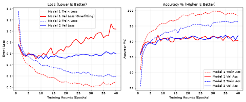
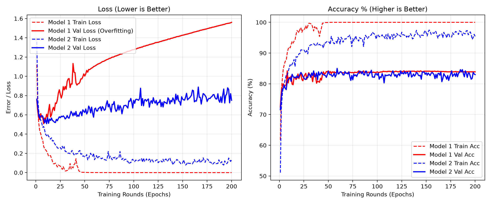
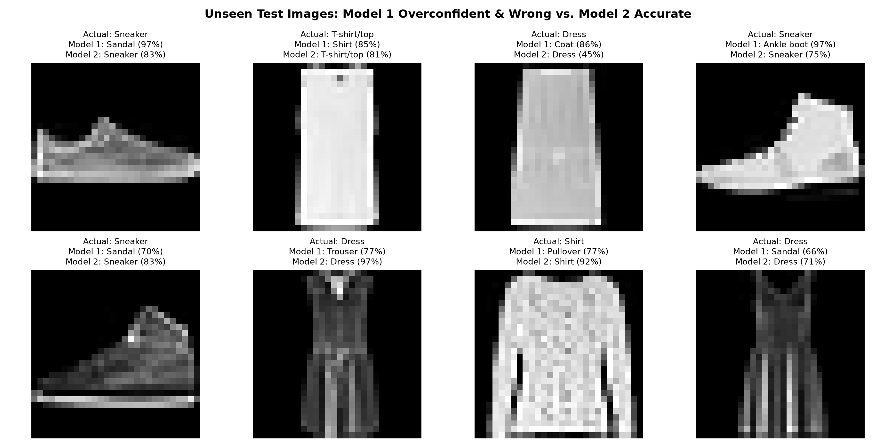

# Neural Network Regularization Demo (Dropout + L2)

A hands-on PyTorch demonstration comparing an unregularized MLP against a regularized MLP (Dropout + L2 weight decay) on Fashion-MNIST (2,000 train / 1,000 validation samples) to illustrate overfitting and generalization.

## Project Structure
- `step1_data.py` — Downloads Fashion-MNIST and creates the 2,000/1,000 train/validation split.
- `step2_model.py` — Defines `ClothingClassifier` (`784 -> 512 -> 256 -> 10`) with optional Dropout (`p=0.4`).
- `step3_train.py` — Trains Model 1 (No Regularization) vs. Model 2 (Dropout `0.4` + L2 `weight_decay=1e-3`) and plots loss/accuracy curves.
- `step4_live_test.py` — Generates a side-by-side visual comparison on unseen validation images (`live_predictions.png`).
- `step5_interactive.py` — Interactive CLI tester to evaluate any test index (`0–999`) or custom image live.

## Key Results

### 40 Epochs (Early Overfitting)
| Model | Train Acc | Val Acc | Val Loss |
| :--- | :---: | :---: | :---: |
| **Model 1 (No Reg)** | 97.0% | 80.7% | 1.039 |
| **Model 2 (Dropout + L2)** | 92.7% | **83.9%** | **0.596** |

### 200 Epochs (Severe Overfitting)
| Model | Train Acc | Val Acc | Val Loss |
| :--- | :---: | :---: | :---: |
| **Model 1 (No Reg)** | 100.0% | 83.9% | 1.561 |
| **Model 2 (Dropout + L2)** | 95.5% | 83.0% | **0.752** |

### Visual Proof on Unseen Test Images

## How to Run
``bash
pip install torch torchvision matplotlib pillow
python step3_train.py
python step4_live_test.py
python step5_interactive.py
``
